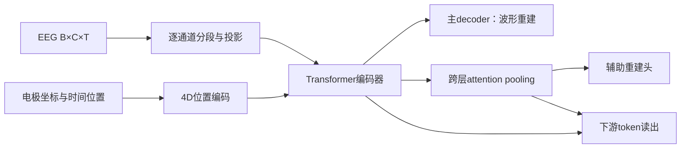

# REVE：研究问题、架构与训练逻辑

> 版本：2026-11-13 / 论文笔记 v0.1。正文基于已保存原文及公开评测；尚未完成代码逐层核验或本地复现。统一记号见[阅读约定](../process/文档维护与阅读约定.md)。

## 研究出发点

EEG 数据的异构性使大规模预训练难以扩展：不同数据集的电极数、位置和片段长度不同，固定导联词表或固定位置表限制了共同训练。作者希望得到能够跨记录配置使用、冻结后也有用的表示。

这里有两个相互关联的设计目标：让编码器接收更多种 EEG；让预训练输出适合下游读出。前者由空间—时间位置表达解决，后者不仅依赖波形重建，还引入跨层聚合的辅助任务。

## 从输入到输出的架构

设输入为 $X\in\mathbb{R}^{B\times C\times T}$，电极坐标为 $P\in\mathbb{R}^{C\times3}$。

1. **分段与线性投影。** 每个通道沿时间切成约1秒的patch。论文配置是200 Hz、窗口200点、重叠0.1秒，即20点；步长180点。每个patch经过线性映射成为D维token，形成 $H_0\in\mathbb{R}^{B\times C\times N\times D}$。通道和时间维的变化主要体现为token数变化。实现时以代码的边界处理为准，不照抄论文中容易产生歧义的patch计数式。
2. **4D位置编码。** 对每个token，将电极的三维坐标与patch的时间位置结合。Fourier位置特征和可学习映射共同表达时空位置；训练时的位置扰动提供空间增强。这使位置具有几何含义，而不是仅给第几个通道一个固定编号。坐标单位和归一化必须与checkpoint匹配。
3. **结构化mask。** mask在时空位置上成块组织，同时包含通道缺失式扰动。遮掉相邻区域比随机遮掉零散patch更难通过附近冗余直接补全。论文默认总mask比例55%，具体mask半径属于训练配置。
4. **Transformer编码器。** 输入token经过注意力与前馈层得到上下文化表示。Small、Base、Large使用不同深度/宽度；论文Base为22层、512维，约69M参数。这些是特定配置，不是REVE思想的必要条件。
5. **主重建路径。** 编码表示经decoder和输出投影恢复原始波形patch。该路径在预训练使用，下游分类不需要生成整段波形。
6. **辅助重建路径。** 从多个编码层收集token，利用学习到的query进行attention pooling，得到紧凑全局表示；再复制该表示、加入位置信息，经过小型前馈网络重建patch。它迫使压缩表示携带可供重建的信息。
7. **下游读出。** 可使用pooled表示，也可使用未池化token。二者的信息组织和分类头容量不同；不能把某个统一池化头的结果视为编码器的全部能力。

## 训练目标与阶段

主要重建损失为L1，不是MSE。用示意式写为

$$\mathcal L_{\mathrm{REVE}}=\mathcal L_{\mathrm{patch},L1}+\lambda\mathcal L_{\mathrm{global},L1}.$$

论文辅助项权重为0.1。主任务学习上下文重建，辅助任务约束压缩后的全局表示；不能把辅助池化、下游平均池化和未池化分类头混为同一种操作。

预训练后分别考察冻结编码器的读出、完整微调与少样本适配。解释Table 4时必须保留模型大小和Pool设置。

## 实验告诉了我们什么

NeuralBench 官方快照 mean_rank=4.22，36项中12项第1、20项前2（本报告按源数据计算，含不同任务指标）。原论文 Table 4：Base 的 FACED pooled 24.0% / unpooled 42.2%，BCI-IV-2a 43.2% / 51.7%。

这些结果的协议和具体源表见[评测证据](../benchmarks/评测证据与可比性.md)。整模型优于另一模型，只能支持该完整设置下的比较；模块作用需要相应消融。

## 局限和仍需核对的问题

强预训练权重的表现不能推导为官方21数据集上从零训练的表现；池化读出有任务依赖；模型与电极坐标、幅值及采样率适配需要核验。已有1秒patch并不证明其丢失了全部高频或相位。

实现核对时重点记录：预处理、实际token形状、位置表示、mask与loss的作用位置、checkpoint版本、可训练模块及读出接口。没有核验到的层数、配置或实现差异不补成确定事实。

## 对本项目的启发

保留其强全局表征和输入灵活性。先建立 pooled、未池化和参数受控结构化读出的基线，再谈增加骨干模块。

上述启发是待验证判断。当前研究问题见[REVE改进假设](../research/REVE改进假设.md)，不能把本笔记中的作者模型和我们的改造方案视为同一个模型。

## 原文与证据

- [REVE（NeurIPS 2025，核对 arXiv v1）](https://arxiv.org/html/2510.21585v1)：§2、Table 3–4、17–20；Table 4 在 PDF 第9页。
- [REVE 作者代码与原生输入示例](https://brain-bzh.github.io/reve/)：200 Hz、电极名称/坐标输入；作者仓库 elouayas/reve_eeg。
- [NeuralBench 官方逐任务结果，固定提交 fe31393](https://github.com/facebookresearch/neuroai/blob/fe31393affab2590e59b0a7e1457aad1a1da908e/docs/_static/neuralbench-results-data.json)：results；36 项 EEG 任务。
- [NeuralBench 官方模型参数与 mean_rank 数据](https://github.com/facebookresearch/neuroai/blob/fe31393affab2590e59b0a7e1457aad1a1da908e/docs/_static/neuralbench-model-scatter-data.json)：models。

- [原始资料目录](../../research/reve_route_20261113/sources/)
- [返回论文索引](README.md)
